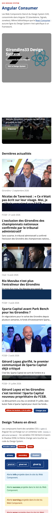

# Girondins33 Angular Consumer

Angular application demonstrating the consumption of Web Components generated by the G33 Design System.

It is the Angular counterpart of the [React Consumer](https://github.com/juliencap/g33-react-consumer): **same component library, no framework-specific code in the Design System.**

## Live Demo

👉 Coming soon on Vercel

## Overview



## Features

- Consumption of Web Components built with Stencil
- Hero Banner integration with Storyblok
- Latest news integration through the WordPress REST API, with "Load more"
- Live Design Tokens playground: runtime theming through `--g33-*` CSS variables
- Angular 22: standalone components, Signals (`signal`, `computed`, `linkedSignal`), `httpResource`, zoneless, built-in control flow (`@if`, `@for`)
- Deployment on Vercel

## Architecture

```text
Storyblok
    ↓
Angular Application
    ↓
Hero Banner

WordPress REST API
    ↓
Angular Application
    ↓
Article Cards
```

## Using the Design System in Angular

### 1. Installation

The Design System is installed directly from GitHub:

```bash
npm install github:juliencap/g33-stencil-design-system
```

### 2. Registering the Web Components (`src/main.ts`)

```ts
import { defineCustomElements } from 'girondins33-design-system/loader';

defineCustomElements(window, { resourcesUrl: '/build/girondins33-design-system/' });
```

The Stencil loader registers the `g33-*` tags and lazy-loads each component on demand.

### 3. Allowing custom elements

Every Angular component that uses a `g33-*` tag declares:

```ts
@Component({
  schemas: [CUSTOM_ELEMENTS_SCHEMA],
  // ...
})
```

### 4. Attributes or properties?

```html
<!-- Static value: HTML attribute, kebab-case -->
<g33-hero-banner title-text="Girondins33" cta-target="_blank" />

<!-- Dynamic value: property binding, camelCase -->
<g33-content-card [contentTitle]="item.title" [showCta]="showCta()" />
```

Angular writes a static value as an **attribute** (read by Stencil in kebab-case) and a bound `[prop]` value as a **JS property** (camelCase, with its real type: boolean, object…).

### 5. Events

Native clicks bubble up from the Shadow DOM, so `(click)` works directly on `<g33-button>`.
A future Stencil `@Event()` (e.g. `g33Change`) will be handled the same way: `(g33Change)="onChange($event.detail)"`.

### 6. Typing

The types generated by Stencil (`components.d.ts`) are reused in Angular:

```ts
import type { Components } from 'girondins33-design-system/types';
type ButtonVariant = Components.G33Button['variant']; // 'primary' | 'secondary' | 'ghost'
```

The `girondins33-design-system/types` alias is declared in `tsconfig.json`, because the Design System's `package.json` does not expose its types in `exports` yet.

### 7. Dev server (Vite pre-bundling)

`ng serve` relies on Vite, which pre-bundles dependencies into `.angular/cache`. It copies the Stencil loader but not the `*.entry.js` chunks the loader imports dynamically, which leads to 404 errors and `Constructor for "g33-button#undefined" was not found`. The Design System is therefore excluded from pre-bundling in `angular.json`:

```json
"serve": {
  "options": {
    "prebundle": { "exclude": ["girondins33-design-system"] }
  }
}
```

After changing this setting, delete `.angular/cache` and restart `ng serve`. The production build is not affected.

## Design Tokens and Shadow DOM

Components read CSS variables (`--g33-color-primary`, `--g33-radius-md`…). The application overrides them on a container:

```html
<div [style.--g33-color-primary]="theme().primary">…</div>
```

**Finding from the integration:** the Design System declares its tokens on `:host, :root`, and Stencil injects this global style into every Shadow DOM. The `:host` rule therefore redefines the tokens inside each component and blocks inheritance from the host application. The consumer works around it with an outer rule on the host element, which takes precedence over `:host`:

```css
.preview :is(g33-button, g33-alert) {
  --g33-color-primary: inherit;
}
```

The clean fix belongs in the Design System: declare the tokens on `:root` only. They then inherit naturally into every Shadow DOM, and any application can override them.

## Roadmap

- **Angular output target** (`@stencil/angular-output-target`) in the Design System: generated Angular wrappers, typed inputs in templates (no more `CUSTOM_ELEMENTS_SCHEMA`) and `ControlValueAccessor` support to plug future form components into Reactive Forms.
- Publish the Design System on npm (or GitHub Packages) with complete `exports` (types, tokens CSS).

## Technologies

- Angular 22
- TypeScript
- Stencil Web Components
- Storyblok
- WordPress REST API
- Vercel

## Development

```bash
cp .env.example .env   # set STORYBLOK_TOKEN
npm install
npm start              # http://localhost:4200
```

`scripts/set-env.mjs` generates `src/environments/environment.ts` from `.env` (or from environment variables on Vercel) before `start` and `build`. Without a token, the Storyblok hero displays an alert instead of breaking the page.

Requires Node.js 22.22.3+ or 24.15+.

## Build

```bash
npm run build
```

Vercel settings:

- Framework: Angular (auto-detected)
- Build command: `npm run build`
- Output directory: `dist/g33-angular-consumer/browser`
- Environment variable: `STORYBLOK_TOKEN`

## Related Projects

🔗 [G33 Design System](https://github.com/juliencap/g33-stencil-design-system)
🔗 [G33 React Consumer](https://github.com/juliencap/g33-react-consumer)

## Author

Julien Cap
